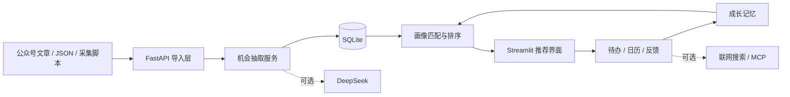

# Opportunity Radar Agent

[](https://github.com/leoh4mster/opportunity-radar-agent/actions/workflows/ci.yml)

> 把碎片化公众号信息转化为可比较、可跟进、可复盘的个人发展机会。

Opportunity Radar Agent 是一个面向大学生和求职者的本地优先 AI Agent。它将公众号文章中的竞赛、实习、科研、讲座等非结构化信息抽取成机会卡片，再结合用户画像、截止时间、成本收益和历史反馈生成个性化推荐，并继续完成待办、日历和成长复盘。

基础流程完全不依赖 API Key；接入自己的 DeepSeek 和搜索服务后，可进一步启用机会问答、成长记忆、联网核验与 AI 推进计划。

## 为什么做这个项目

公众号里的机会信息通常存在三个问题：信息分散、格式不统一、看到后很难持续跟进。这个项目不是简单地“总结一篇文章”，而是把信息处理成一条可持续运行的决策链路：

```text
文章采集 → 结构化抽取 → 个性化排序 → 风险核验 → 行动计划 → 行为反馈 → 成长记忆
```

## 核心能力

- 文章导入：支持示例 JSON 和清洗后文章接口，自动去重并保存到 SQLite。
- 机会抽取：识别类型、主办方、截止日期、地点、人群、要求和报名入口。
- 个性化推荐：综合目标、技能、兴趣、时间地点偏好、收益、成本和截止日期排序。
- 行动 Agent：围绕单个机会执行核验、信息补全、待办创建和日历提醒。
- 反馈闭环：记录“有用”“不感兴趣”“已申请”等行为，影响后续推荐。
- 成长记忆：把长期行为聚合为阶段判断、关注重点、偏好变化和下一步建议。
- 降级运行：未配置大模型或联网搜索时，自动使用确定性本地规则完成基础链路。
- 产品总览：实时展示文章处理率、机会分布、个人行动和可选能力状态。

## 系统架构



| 层次 | 技术 | 职责 |
| --- | --- | --- |
| 前端 | Streamlit | 产品总览、画像管理、推荐浏览和行动交互 |
| API | FastAPI + Pydantic | REST 接口、参数校验和错误边界 |
| 业务 | Service + Tool Registry | 抽取、排序、Agent 工具、记忆和推进计划 |
| 数据 | SQLAlchemy + SQLite | 本地持久化、状态流转和行为记录 |
| AI | DeepSeek（可选） | 高质量抽取、问答、反思和计划生成 |
| 搜索 | 博查 / 微信 MCP（可选） | 最新信息核验与公众号搜索 |

## 快速启动

需要 Python 3.9 或更高版本。

```bash
cd opportunity-radar-agent
python3 -m venv .venv
source .venv/bin/activate
python -m pip install -r requirements.txt
cp .env.example .env
python -m app.seed
```

终端 1：

```bash
sh run_backend.sh
```

终端 2：

```bash
sh run_frontend.sh
```

打开：

- 产品界面：http://127.0.0.1:8501
- API 文档：http://127.0.0.1:8000/docs
- 健康检查：http://127.0.0.1:8000/health
- 总览接口：http://127.0.0.1:8000/dashboard/summary

## 推荐演示路径

1. 在“总览”展示当前文章、机会、推荐以及能力状态。
2. 在“用户画像”说明目标、技能和偏好如何进入推荐系统。
3. 在“文章库 → 机会库”展示非结构化信息如何变成结构化机会。
4. 在“推荐排序”解释推荐原因，并从原文页创建待办或日历提醒。
5. 用“反馈 → 成长记忆”说明系统如何形成长期闭环。

## 本地模式与增强模式

| 能力 | 无 API Key | 配置外部服务后 |
| --- | --- | --- |
| 文章导入、数据库、画像 | 可用 | 可用 |
| 机会抽取 | 本地规则 | DeepSeek 语义抽取 + 本地兜底 |
| 推荐排序 | 确定性评分与本地说明 | 大模型辅助解释 |
| 待办和日历 | 可用 | 可用 |
| 机会助理、成长记忆、AI 推进 | 不可用或有限 | 完整可用 |
| 最新信息核验 | 不可用 | 使用自己的搜索服务 |

## 测试与质量保证

```bash
cd opportunity-radar-agent
python -m unittest discover -s tests -v
python -m compileall -q app frontend
```

GitHub Actions 会在 Python 3.9 和 3.12 上自动执行测试与编译检查。当前测试重点覆盖：

- 总览聚合指标与用户隔离
- 数据管道状态判断
- 无 API Key 的机会抽取兜底
- 非机会文章过滤
- 本地推荐解释生成

## 目录结构

```text
.
├── opportunity-radar-agent/   # 主产品：API、前端、业务服务与测试
├── pyautogui/scripts/         # 实验性桌面公众号采集器
├── mouse+catch/               # 截图与 OCR 可行性实验
└── browser try/               # 浏览器控制可行性实验
```

主产品的详细运行说明见 [opportunity-radar-agent/README.md](opportunity-radar-agent/README.md)，架构取舍见 [设计文档](opportunity-radar-agent/docs/design.md)，面试讲解建议见 [INTERVIEW_GUIDE.md](opportunity-radar-agent/docs/INTERVIEW_GUIDE.md)。

## 安全设计

- 真实密钥只从 `.env` 或操作系统环境变量读取。
- `.env`、SQLite、日志、虚拟环境和采集截图不会进入 Git。
- 日志只记录模型和服务状态，不输出密钥。
- 外部 AI 和搜索服务均为可选依赖，基础功能可离线演示。

## Roadmap

- [x] 无密钥本地运行与敏感信息清理
- [x] 总览仪表盘、核心测试和 GitHub CI
- [ ] 整理桌面采集实验并形成独立 Collector 模块
- [ ] 引入 Alembic 数据库迁移和结构化日志
- [ ] 增加推荐效果评测集与可解释性对比
- [ ] 增加用户登录、权限隔离和可部署版本
- [ ] 补充真实产品截图和演示视频
